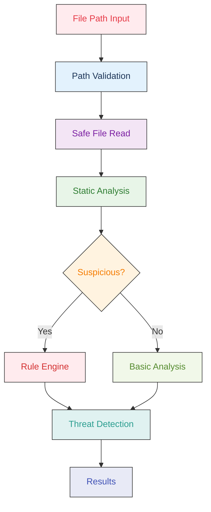

# What NullVoid detects

How the scanner finds malicious code, what it looks for and what it has caught. For the ML side see [../ml-model/README.md](../ml-model/README.md).

## What NullVoid Detects

### Wallet Hijacking
- **window.ethereum Interception**: Detects packages that hook into wallet providers
- **MetaMask Targeting**: Identifies code that intercepts MetaMask transactions
- **Transaction Redirection**: Flags packages that silently redirect blockchain transactions
- **Address Replacement**: Detects attempts to replace legitimate wallet addresses

### Network Manipulation
- **Fetch/XMLHttpRequest Overrides**: Detects packages that intercept network requests
- **API Response Scanning**: Identifies code that scans responses for blockchain addresses
- **Address Substitution**: Detects replacement of legitimate addresses with attacker-controlled ones

### Supply Chain Attacks
- **Postinstall Script Analysis**: Detects suspicious postinstall scripts
- **Code Entropy Analysis**: Identifies obfuscated or packed code
- **GPG Signature Verification**: Validates package signatures
- **Suspicious File Patterns**: Scans for malicious naming conventions

### Advanced Detection
- **Multi-Chain Targeting**: Detects packages supporting multiple blockchains
- **Stealth Controls**: Identifies hidden control interfaces
- **Obfuscation Techniques**: Detects code hiding mechanisms
- **Deep Dependency Scanning**: Scans transitive dependencies up to 3 levels deep

## Security Features

### Core Security Engine
- **Static Threat Detection**: Structural pattern analysis (obfuscator identifiers, hex arrays, decode-and-execute chains) plus built-in rules; nothing is executed
- **Multi-Layer Security**: Comprehensive static analysis with multiple detection methods
- **Path Security**: Protection against path traversal and command injection attacks
- **Input Validation**: Comprehensive input sanitization and validation
- **Safe Config Loading**: Rules and config files loaded with restricted YAML schema (JSON_SCHEMA) to prevent arbitrary code execution from untrusted input

### Threat Detection Capabilities
- **Obfuscated Malware**: Detection of variable name mangling, hex encoding, and anti-debugging patterns
- **Wallet Hijacking**: Comprehensive cryptocurrency attack detection and prevention
- **Supply Chain Attacks**: Enhanced detection of malicious npm packages and dependency injection
- **Dependency Confusion**: Timeline analysis comparing git history vs npm registry creation dates
- **Module Loading Threats**: Dynamic require detection and system module access monitoring
- **Code Structure Analysis**: Entropy analysis and malicious code pattern recognition

### Production Features
- **Clean Resource Management**: No open handles, proper cleanup, and memory leak prevention
- **Real-Time Progress**: Live scanning display with consistent threat reporting
- **CI/CD Ready**: Reliable integration into automated workflows
- **Smart Classification**: Intelligent differentiation between legitimate tools and real threats
- **Color-Coded Output**: Visual distinction between threat severities and types

## What Can NullVoid Scan?

NullVoid is not just for npm packages - it's a comprehensive security scanner for any JavaScript/Node.js codebase:

### Project Types
- **Web Applications**: React, Vue, Angular projects
- **Node.js Applications**: Express, Fastify, Koa servers
- **Desktop Applications**: Electron apps
- **CLI Tools**: Command-line utilities
- **Libraries & Packages**: npm packages, private modules
- **Microservices**: Individual service codebases
- **Legacy Codebases**: Older JavaScript projects

### Scan Targets
- **Individual Files**: `nullvoid suspicious-file.js`
- **Project Directories**: `nullvoid ./my-project`
- **npm Packages**: `nullvoid express`
- **Dependencies**: `nullvoid ./node_modules`
- **Git Repositories**: `nullvoid ./git-repo`
- **Production Code**: Pre-deployment security checks
- **CI/CD Pipelines**: Automated security scanning

### Use Cases
- **Pre-deployment Security**: Catch malicious code before production
- **Supply Chain Protection**: Scan dependencies for threats
- **Code Review**: Security analysis during development
- **Incident Response**: Analyze suspicious files safely
- **Compliance**: Meet security requirements and standards
- **Audit Preparation**: Comprehensive security assessment

### Complete Scanning Process



**Process Flow:**
1. **Path Validation**: Secure path checking and traversal protection
2. **Safe File Read**: Direct filesystem access with security measures
3. **Static Analysis**: Structural pattern detection without execution
4. **Suspicious Detection**: Heuristic analysis for malicious indicators
5. **Rule Engine**: Built-in and custom regex rules applied to every file (`--no-builtin-rules` to skip)
6. **Threat Detection**: Comprehensive threat identification and classification
7. **Results**: Detailed security report with actionable insights

## Real-World Attack Detection

NullVoid detects sophisticated supply chain attacks like the recent npm compromise:

### Recent Attack: debug, chalk, and 16 other packages
- **Attack Vector**: Wallet hijacking through `window.ethereum` interception
- **Technique**: Silent transaction redirection to attacker-controlled addresses
- **Multi-Chain**: Targeted Ethereum, Bitcoin, Litecoin, Tron, BCH, and Solana
- **Stealth**: Used obfuscation and `stealthProxyControl` global object

### How NullVoid Detects This:
```bash
nullvoid .
# Results show:
⚠️  4 threat(s) detected:

1. WALLET_HIJACKING: Package may contain wallet hijacking code
   Severity: CRITICAL

2. NETWORK_MANIPULATION: Package may manipulate network responses
   Severity: HIGH

3. MULTI_CHAIN_TARGETING: Package supports multiple blockchain networks
   Severity: MEDIUM

4. STEALTH_CONTROLS: Package contains stealth controls or obfuscation
   Severity: HIGH
```

## Dependency Confusion Detection

NullVoid includes advanced **Dependency Confusion Detection** to identify potential supply chain attacks where malicious packages are created to exploit package resolution vulnerabilities.

### Detection Methods

### Timeline Analysis
- **Git History vs Registry Creation**: Compares package creation dates with git commit history
- **Suspicious Timing**: Flags packages created suspiciously close to first git commits
- **Risk Levels**: 
  - `CRITICAL`: Package created < 1 day before git history
  - `HIGH`: Package created < 7 days before git history  
  - `MEDIUM`: Package created < 30 days before git history

### Scope Analysis
- **Private Scope Detection**: Identifies packages using private scopes (`@company`, `@internal`, etc.)
- **Namespace Conflicts**: Detects potential namespace confusion attacks
- **Registry Configuration**: Warns about improper npm registry setup

### Pattern Analysis
- **Suspicious Naming**: Detects typosquatting and naming confusion patterns
- **Activity Analysis**: Identifies packages with suspiciously low git activity
- **Similarity Scoring**: Uses Levenshtein distance for name similarity analysis

### Example Detection Output
```bash
🔍 Analyzing dependency confusion patterns...

⚠️  3 dependency confusion threat(s) detected:

1. DEPENDENCY_CONFUSION_TIMELINE: Package creation date suspiciously close to git history (2 days)
   Package: @company/internal-auth
   Severity: HIGH
   Details: Package created: 2023-12-01T00:00:00.000Z, First git commit: 2023-11-29T00:00:00.000Z

2. DEPENDENCY_CONFUSION_SCOPE: Private scope package may be vulnerable to dependency confusion
   Package: @company/internal-auth
   Severity: HIGH
   Details: Private scope '@company' detected. Ensure proper npm registry configuration.

3. DEPENDENCY_CONFUSION_PATTERN: Package name follows suspicious naming patterns
   Package: abc123def
   Severity: MEDIUM
   Details: Suspicious patterns: /^[a-z]+\d+[a-z]+$/
```

### Protection Recommendations

### For Private Packages
- Use scoped packages: `@yourcompany/package-name`
- Configure `.npmrc` files properly
- Use private npm registries
- Implement package signing

### For Public Packages
- Verify package authenticity
- Check git history and activity
- Use package-lock.json files
- Monitor for suspicious updates

### ML-Powered Threat Scoring

NullVoid can use trained XGBoost models for threat scoring:
- **Dependency confusion** (`ML_MODEL_URL`): Timeline, registry, commit patterns
- **Behavioral** (`BEHAVIORAL_MODEL_URL`): Package scripts, network usage, eval, child processes

When configured, scans send feature vectors to the models and incorporate scores into threat detection. Optional `ML_EXPLAIN` enables human-readable reasons and feature importance.

**Setup:** See [ML Training Pipeline](#-ml-training-pipeline) for the full pipeline (`nullvoid export` → `scan --train` → `nullvoid train` → `nullvoid serve`).

Configure via `.nullvoidrc` or environment:

```json
{
  "DEPENDENCY_CONFUSION_CONFIG": {
    "ML_DETECTION": {
      "ML_MODEL_URL": "http://localhost:8000/score",
      "BEHAVIORAL_MODEL_URL": "http://localhost:8000/behavioral-score",
      "ML_EXPLAIN": true,
      "MODEL_TIMEOUT": 5000,
      "ML_PREDICTIVE_THRESHOLD": 0.4
    }
  },
  "RISK_CONFIG": {
    "highRiskThreshold": 7,
    "criticalRiskThreshold": 9
  },
  "SUPPLY_CHAIN_CONFIG": {
    "MAX_DEPTH": 6,
    "MAX_NODES": 5000,
    "PROPAGATION_DECAY": 0.85,
    "PROPAGATION_THRESHOLD": 0.3
  }
}
```

- `MODEL_TIMEOUT` — max milliseconds to wait for the ML service (default `5000`)
- `ML_PREDICTIVE_THRESHOLD` — minimum score to flag a package as high-risk via ML (default `0.4`)
- `RISK_CONFIG` — override composite risk thresholds without redeploying
- `SUPPLY_CHAIN_CONFIG` — bound dependency graph traversal and tune how far risk propagates from a compromised dependency to the packages that depend on it

Or: `export NULLVOID_ML_MODEL_URL=http://localhost:8000/score`

See [ml-model/README.md](../ml-model/README.md) for training and API details.

### Configuration

Dependency confusion detection can be configured via environment variables:

```bash
# Enable/disable dependency confusion analysis
NULLVOID_DEPENDENCY_CONFUSION_ENABLED=true

# Adjust timeline thresholds (days)
NULLVOID_TIMELINE_SUSPICIOUS=30
NULLVOID_TIMELINE_HIGH_RISK=7
NULLVOID_TIMELINE_CRITICAL=1

# Registry request timeout (ms)
NULLVOID_REGISTRY_TIMEOUT=10000
```

### API Server Security

The REST API (`packages/api`) enforces the following by default:

| Setting | Default | Notes |
|---------|---------|-------|
| `CORS_ORIGIN` | `*` | **Set an explicit origin in production.** The server logs a warning if left as wildcard. |
| `NULLVOID_API_KEY` | _(unset — open)_ | Set to enable `X-API-Key` auth on all routes. |
| Rate limiting | 10 req/min (`POST /scan`), 20 req/min (ML routes) | Configurable via `express-rate-limit`. |
| Request body cap | 256 kb | Requests over this limit return `413`. |
| `GET /scans` pagination | `?limit=50&offset=0` | `limit` is clamped to `[1, 100]`; `offset` to `≥ 0`. |
